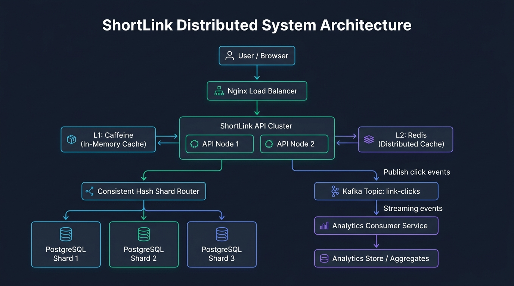

# ShortLink

ShortLink is a production-grade, distributed URL shortening and click-analytics platform built with Spring Boot, PostgreSQL, Redis, Kafka, and Docker.

## Project Status

- **Current Phase**: Phase 1 - Modular Monolith
- **Milestone**: Day 5 - Docker Packaging, Single-Command Compose & k6 Redirect Benchmarks
- **Status**: **Phase 1 Complete**. Full stack containerized with hardened multi-stage Dockerfile, automated PostgreSQL 16 orchestration via Docker Compose, 40/40 tests passing, and baseline k6 load test verified.

## Architecture



ShortLink is designed as a modular monolith transitioning to an event-driven distributed architecture:

1. **Modular Monolith Foundation (Phase 1 Complete)**:
   - `com.shortlink.api`: REST endpoints (`POST /api/v1/links`, `GET /{shortCode}`, `GET /api/v1/links/{shortCode}`, `DELETE /api/v1/links/{shortCode}`, `/api/v1/ping`)
   - `com.shortlink.service`: Core URL shortening, SSRF defense, vanity alias validation, and HTTP 302 redirect engine
   - `com.shortlink.idgen`: Twitter Snowflake 64-bit ID generator with Base62 encoding and backward clock-drift protection
   - `com.shortlink.domain`: JPA entities, Flyway migrations, and derived repository queries
   - `com.shortlink.config`: Infrastructure, database, and security configurations
1. **Upcoming Distributed Components (Phase 2 & Beyond)**:
   - Multi-tier caching: Caffeine local cache + Redis distributed cache-aside (targeting >50,000 req/sec)
   - Async click analytics: Kafka event streaming with an isolated consumer service
   - Scalable data layer: Consistent-hash sharding across multiple PostgreSQL instances
   - Observability: Prometheus metrics, Grafana dashboards, and Actuator health checks

## Benchmarks & Baseline Performance (Phase 1)

Measured via automated `k6` load testing directly against PostgreSQL 16 (zero cache):

- **Redirect Throughput**: **2,353 requests/sec** (50 concurrent VUs, 58,998 total requests)
- **Redirect Latency**:
  - `p95`: **2.95 ms** (Target `< 10ms` easily achieved)
  - `p90`: **2.21 ms**
  - `median`: **995 µs** (Sub-millisecond redirect resolution)
  - `average`: **1.30 ms**
- **HTTP Error Rate**: **0.00%** (0 out of 58,998 requests failed)
- **Automated Test Suite**: **40 / 40 passed (100%)**

_(Phase 2 will introduce Redis + Caffeine caching to push throughput beyond 50,000 req/sec)._

## Video Recording Guides (YouTube Series)

Detailed presenter walkthroughs, spoken video scripts, and code explanations mapped to each commit are located in [`docs/video/`](docs/video/):

- **[Phase 1 Series Overview](docs/video/00_Phase1_Playlist_Overview.md)**
- **[Episode 1: Project Skeleton & Docker Postgres](docs/video/Episode_01_Project_Skeleton_and_Docker_Postgres.md)**
- **[Episode 2: Twitter Snowflake 64-bit ID Generator & Base62](docs/video/Episode_02_Snowflake_ID_Generator_and_Base62.md)**
- **[Episode 3: Flyway Schema Migrations, Partial Indexing & JPA](docs/video/Episode_03_Flyway_Database_Migration_and_JPA.md)**
- **[Episode 4: Core REST APIs, Redirect Engine & SSRF Defense](docs/video/Episode_04_REST_APIs_Redirect_Engine_and_Postman.md)**
- **[Episode 5: Production Docker Packaging & k6 Benchmarks](docs/video/Episode_05_Production_Docker_and_k6_Benchmarks.md)**

## Prerequisites

- Java 25 (or compatible JDK)
- Docker & Docker Compose
- Maven (or included `./mvnw` wrapper)

## Getting Started

### 1. Single-Command Startup (Production Docker Stack)

Run the entire application and PostgreSQL database with a single command:

```bash
docker compose up --build -d
```

Verify container status:

```bash
docker compose ps
```

Verify application health:

```bash
curl -i http://localhost:8080/actuator/health
```

### 2. Run k6 Load Benchmark

Run the automated 50-VU redirect load test using the official Grafana k6 container:

```bash
docker run --rm -i --network shortlink_default -e TARGET_URL=http://app:8080 grafana/k6:latest run - < k6/baseline-redirect-test.js
```

### 3. Local Development (Optional)

Start PostgreSQL:

```bash
docker compose up -d postgres
```

Build and run the Spring Boot application locally:

```bash
./mvnw clean compile
./mvnw spring-boot:run
```

### 4. Run Test Suite

```bash
./mvnw test
```
